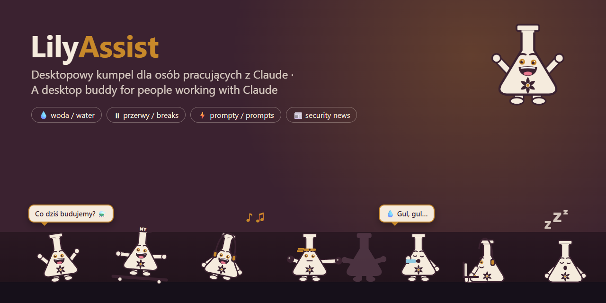

# LilyAssist ⚗️

**Desktopowy kumpel dla osób pracujących z Claude.** Mała kremowa kolba z logo Black Lily Labs chodzi po dole ekranu, motywuje do kodowania, pilnuje przerw i nawodnienia, podsuwa gotowe prompty i informuje o statusie Claude oraz ważnych newsach z IT i cyberbezpieczeństwa.

Windows 10/11 · Electron · polski i angielski · licencja MIT · [English version](README.en.md)



> **Znaki towarowe:** Claude jest znakiem towarowym Anthropic, PBC. LilyAssist to niezależny projekt open source od Black Lily Labs. Nie jest powiązany z Anthropic ani przez nią wspierany.

---

## Co potrafi

### 🤖 Praca z Claude
- **Klik w kolbę** otwiera aplikację Claude Desktop.
- **Szybkie prompty**: gotowe polecenia (wyjaśnij błąd, code review, napisz testy, uprość kod, wyjaśnij kod, najpierw plan, commit message, README) i **własne prompty**. Klik kopiuje prompt do schowka i otwiera Claude, więc wystarczy wkleić (Ctrl+V).
- **Szybkie menu** pod prawym przyciskiem albo **Ctrl+Alt+P**: Otwórz Claude, prompty, limity zużycia.
- **Status Claude**: co 5 minut sprawdza [status.claude.com](https://status.claude.com). Nowa awaria = ważny alert, a powrót do normy = „✅ Claude znowu działa”.
- **Czas z Claude**: liczy, jak długo dziś pracujesz z Claude (Claude Desktop, Claude Code w terminalu albo claude.ai na wierzchu).
- **Przypominajka o commicie**: gdy w wybranym repozytorium git zmiany czekają dłużej niż godzinę, kolba przypomina o commicie i otwiera terminal w tym folderze.

### 🎯 Motywacja
- **Cel dnia**: rano pyta „Co dziś budujemy?”, a wieczorem „Udało się?”.
- **Serie dni** z rzędu: woda, kodowanie (15+ min z Claude) i cel dnia.
- **Statystyki dnia** z wieczornym podsumowaniem.
- **Tryb skupienia** (pomodoro, 25 min): kolba siada z laptopem w słuchawkach i milczy.
- Co ok. 20 sekund żart, ciekawostka z IT albo news, a co minutę jakieś zajęcie (najczęściej bieganie). Po dłuższej bezczynności pyta „Nuda… robimy coś?”.

### 💧 Zdrowie
- **Woda**: przypomina o szklance według dziennego celu (domyślnie 2000 ml rozłożone na 8 h pracy, czyli szklanka co ok. 48 min) i liczy, ile dziś wypite. Zalecenie [EFSA](https://pmc.ncbi.nlm.nih.gov/articles/PMC4473081/table/Tab1) dla dorosłych to ok. 1,6–2,0 l napojów dziennie.
- **Przerwy**: co 60 minut pracy proponuje 15 minut przerwy (przekąska, pompki, ruch). Przerwa to przełącznik w menu: po powrocie ją odznaczasz.
- **Oczy (20-20-20)**: co 20 minut krótki dymek „popatrz 20 sekund w dal”.
- **Dźwięk przypomnień**: ciche „plum” przy wodzie i „ding-dong” przy przerwie. Milczy, gdy gra muzyka, film albo trwa rozmowa. Wyłączysz go w menu albo w ustawieniach (tam też przycisk ▶ Posłuchaj).
- W czasie twojej przerwy kolba też odpoczywa: siedzi na ziemi i chrapie „ZZz”.
- Liczy się tylko czas, gdy faktycznie pracujesz, a 10+ minut z dala od komputera to też przerwa.

### 📰 Newsy i alerty
- Newsy z kanałów RSS: Sekurak, Niebezpiecznik, Hacker News, The Hacker News, Krebs on Security, Dark Reading, The Record, Help Net Security i CISA. Możesz dodać **własne kanały**.
- **Ważne alerty** (nowe luki, CVE, zero-day, ransomware, wycieki) pokazują się w czerwonym dymku. Klik otwiera artykuł.

### 🎭 Zabawa
Kolba sama robi różne rzeczy: jeździ na deskorolce (kickflip!), wspina się po krawędzi ekranu (i zjeżdża, skacze z saltem albo na spadochronie), boksuje z cieniem, słucha muzyki, biega, ogląda coś na laptopie, łapie kursor na lasso i przeskakuje go.

### 🤫 Tryby
- **Nie przeszkadzaj**: zamienia się w duszka i znika. Wraca tylko z ważnym alertem.
- **Budzik ekranu** (domyślnie wyłączony – włączysz w menu albo w ustawieniach): gdy przez 3 minuty nie ruszasz myszą i nic nie gra, lekko przeciąga kursor lassem, żeby ekran nie zgasł.
  > ⚠️ To wstrzymuje też automatyczną blokadę ekranu Windows. Dlatego jest domyślnie wyłączony; na komputerze służbowym raczej go nie włączaj.

---

## Instalacja

### Gotowy instalator (najprościej)

1. Pobierz `LilyAssist-Setup-0.6.0.exe` z [najnowszego wydania na GitHubie](https://github.com/blacklilylabs/lilyassist/releases/latest).
2. Uruchom go i przejdź przez instalator. LilyAssist dostaje skrót w menu Start i na pulpicie.
3. Żeby klik w kolbę otwierał Claude, zainstaluj aplikację [Claude Desktop](https://claude.ai/download).

> Windows SmartScreen może ostrzec „System Windows ochronił ten komputer”, bo instalator nie ma płatnego podpisu cyfrowego. Kliknij **Więcej informacji → Uruchom mimo to**.

Odinstalowanie: **Ustawienia Windows → Aplikacje → LilyAssist → Odinstaluj**.

### Zbuduj instalator sam

Potrzebujesz [Node.js](https://nodejs.org) (wersja LTS).

1. Pobierz kod (zielony przycisk **Code → Download ZIP** na GitHubie) i rozpakuj go, albo sklonuj repozytorium.
2. Otwórz PowerShell w folderze projektu i zainstaluj zależności:

   ```bash
   npm.cmd install
   ```

3. Zbuduj instalator. Za pierwszym razem trwa to kilka minut:

   ```bash
   npm.cmd run dist
   ```

4. Uruchom `dist\LilyAssist-Setup-0.6.0.exe` i przejdź przez instalator.

### Uruchomienie z kodu (dla programistów)

```bash
npm.cmd install
```

```bash
npm.cmd start
```

**Tryb demo** (wszystko dzieje się dużo częściej, przydatny do testów):

```bash
npm.cmd run demo
```

> Używamy `npm.cmd` zamiast `npm`, bo domyślne ustawienia PowerShella w Windows często blokują skrypty `npm.ps1`.

---

## Obsługa

### Mysz
| Akcja | Co robi |
|---|---|
| Lewy klik na kolbie | otwiera Claude Desktop |
| Prawy klik na kolbie | szybkie menu (Claude, prompty, limity) |
| Klik / prawy klik na dymku z newsem | otwiera artykuł |
| Klik na przypominajce | „zrobione” (wypite / przerwa / commit / cel), ✕ = później |

### Skróty klawiszowe (działają w każdym programie)
| Skrót | Co robi |
|---|---|
| **Ctrl+Alt+P** | szybkie menu przy kursorze |
| **Ctrl+Alt+0** | otwórz Claude |
| **Ctrl+Alt+1…9** | od razu dany prompt (1–8 wbudowane, kolejne to twoje) |

Na polskiej klawiaturze Ctrl+Alt działa jak AltGr, dlatego skróty nie używają liter z ogonkami. Ctrl+Alt+Spacja zwykle zajmuje Claude Desktop.

### Menu ikony w zasobniku (obok zegara)
- **STATUS**: status Claude, wypita woda, czas z Claude, cel dnia, serie dni, statystyki dnia
- **CLAUDE**: Otwórz Claude, Szybkie prompty, Szybkie menu, Limity Claude
- **ZDROWIE**: Wypita szklanka, Przerwa (przełącznik), Dźwięk przypomnień
- **TRYBY**: Tryb skupienia, Nie przeszkadzaj, Nie daj zgasnąć ekranowi
- **LUDZIK**: Niech coś powie, Pokaż intro, Pokazuj ludzika
- **APLIKACJA**: Uruchamiaj z Windows, Język / Language, Ustawienia i kanały RSS…, Zamknij

Windows 11 często chowa nowe ikony pod strzałką **^** przy zegarze. Przeciągnij ikonę na pasek, żeby była zawsze widoczna.

### Ustawienia
Okno **Ustawienia i kanały RSS…** pozwala ustawić:
- język,
- tryby,
- zdrowie (cel picia, szklanka, przerwy, oczy, dźwięk przypomnień),
- kodowanie (status Claude, długość skupienia, folder repozytorium do przypominajki o commicie),
- własne prompty,
- kanały RSS (wbudowane i własne, opcjonalnie oznaczone jako „ważne”).

Ustawienia zapisują się od razu w `%APPDATA%\LilyAssist\settings.json`. Przy pierwszym uruchomieniu LilyAssist przenosi tu same ustawienia z poprzednich wersji (CodeBuddy, OctoBuddy).

---

## Prywatność

LilyAssist działa lokalnie i nie ma żadnego konta ani telemetrii.

- **Łączy się tylko z:** kanałami RSS, które masz włączone, API Hacker News i [status.claude.com](https://status.claude.com). Nic o tobie nie wysyła.
- **Lokalnie czyta:**
  - tytuł i nazwę programu w oknie na wierzchu (żeby policzyć czas z Claude),
  - poziom dźwięku (żeby budzik ekranu nie przeszkadzał przy filmie),
  - czas od ostatniego ruchu myszą/klawiaturą,
  - `git status` w folderze, który sam wskażesz.
- **Niczego z tego nie zapisuje poza** liczbami w statystykach dnia w pliku ustawień.

---

## Dostosowanie

| Co zmienić | Gdzie |
|---|---|
| Teksty dymków, żarty, ciekawostki, wbudowane prompty (PL i EN) | `src/messages.js` |
| Teksty menu | `src/i18n.js` |
| Czasy: bezczynność, przypominajki, odświeżanie RSS i statusu, godzina podsumowania | `src/main.js`, obiekt `CONFIG` |
| Wbudowane kanały RSS i słowa „ważnych” wpisów | `src/news.js` (`BUILTIN_FEEDS`, `IMPORTANT`) |
| Wygląd kolby i kolory | `src/sprite.js` |
| Rozmiar (`SCALE`: 1 = mały, 2 = domyślny), prędkość, rytm, wspinaczka | `src/renderer/pet.js` (`SCALE`, `SPEED`, `TALK_EVERY`, `FUN_EVERY`, `FUN`, `CLIMB_*`) |

Po zmianach uruchom ponownie (`npm.cmd start`) albo zbuduj nowy instalator (`npm.cmd run dist`).

## Struktura projektu

```
src/
  main.js          – serce aplikacji: okno, menu w zasobniku, przypominajki, alerty, skróty
  preload.js       – bezpieczny most między oknem z kolbą a main.js
  messages.js      – wszystkie teksty dymków (pl / en)
  i18n.js          – teksty menu (pl / en)
  sprite.js        – rysunek kolby (wektorowy) i kolory
  news.js          – kanały RSS i wykrywanie ważnych wpisów
  claudeStatus.js  – status Claude
  git.js           – sprawdzanie zmian w repozytorium, otwieranie terminala
  stats.js         – statystyki i serie dni
  system.js        – funkcje Windows przez bibliotekę koffi (okno na wierzchu, dźwięk, mysz, klawisze)
  settings.js      – zapis i odczyt ustawień
  trayIcon.js      – ikona w zasobniku
  renderer/        – to, co widać: kolba, animacje, dymki
  settings/        – okno ustawień
  goal/            – okienko „Cel dnia”
scripts/make-icon.js – tworzy ikony aplikacji i zasobnika z rysunku kolby
```

---

## Gdy coś nie działa

- **Brak `electron.exe` po `npm.cmd install`** („Electron failed to install correctly”): nowsze wersje npm potrafią pominąć pobieranie samego Electrona. Uruchom:

  ```bash
  node node_modules\electron\install.js
  ```

- **Klik nie otwiera Claude**: sprawdź, czy masz zainstalowany Claude Desktop. Link `claude://` rejestruje właśnie ta aplikacja.
- **Nie widać ikony przy zegarze**: jest pod strzałką **^**.
- **Skrót nie działa**: inny program mógł go zająć. Wtedy w konsoli (`npm.cmd start`) pojawi się „Skrót zajęty przez inny program”.

---

## Licencja

[MIT](LICENSE) © 2026 Black Lily Labs

Claude jest znakiem towarowym Anthropic, PBC. LilyAssist nie jest powiązany z Anthropic ani przez nią wspierany.
